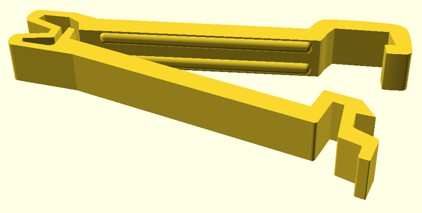
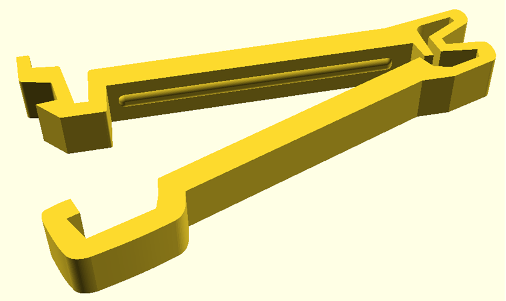

|[:skull:ISSUE](https://github.com/frankyhub/Beutelklipp/issues?q=is%3Aissue)|[:speech_balloon: Forum /Discussion](https://github.com/frankyhub/Beutelklipp/discussions)|[:grey_question:WiKi](https://github.com/frankyhub/Beutelklipp/wiki)||
|--|--|--|--|
| | | | |
<a href="https://github.com/frankyhub/Beutelklipp/issues">|<a href="https://github.com/frankyhub/Beutelklipp/discussions">|<a href="https://github.com/frankyhub/Beutelklipp/6eleases">||
|| <a href="https://github.com/frankyhub/Beutelklipp/pulse" alt="Activity">| <a href="https://github.com/frankyhub/Beutelklipp/graphs/traffic">  |<a href="https://github.com/frankyhub?tab=stars"> ||

 
   

 
   

